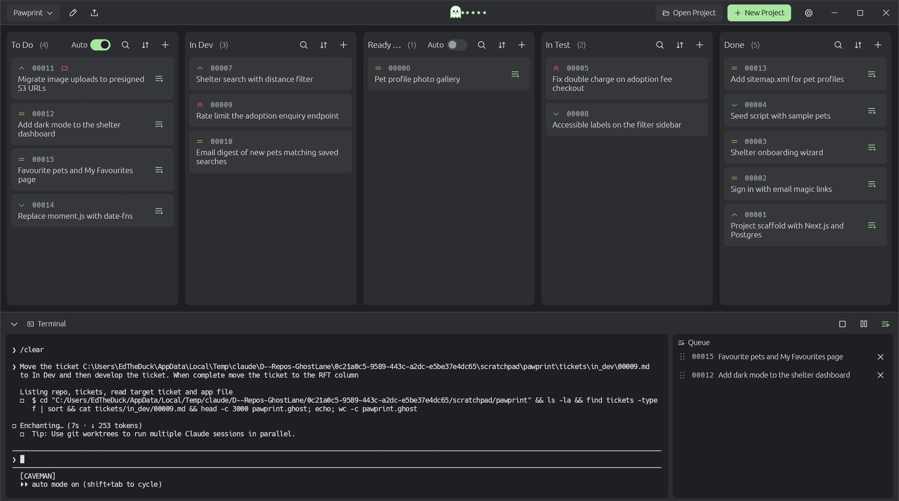
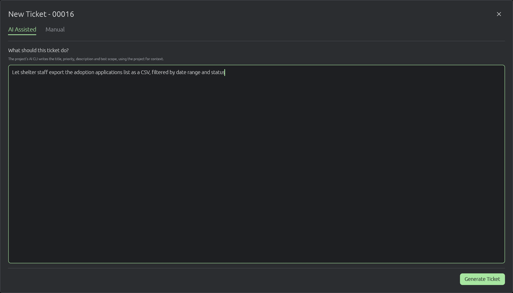
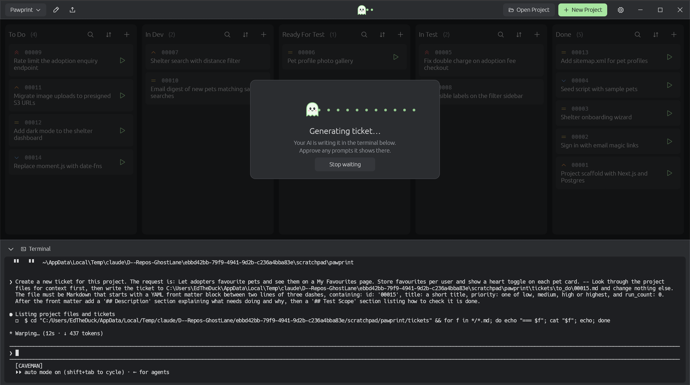
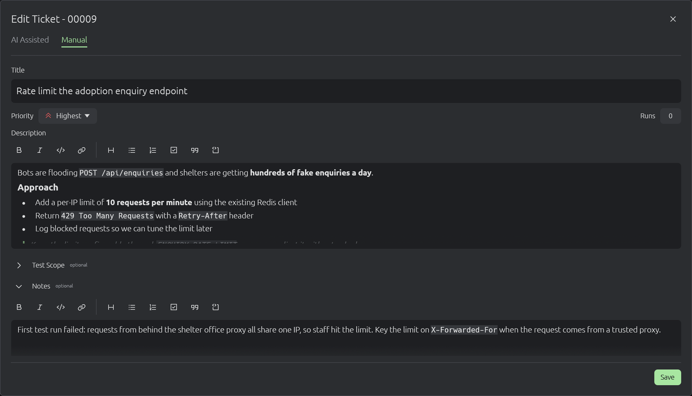
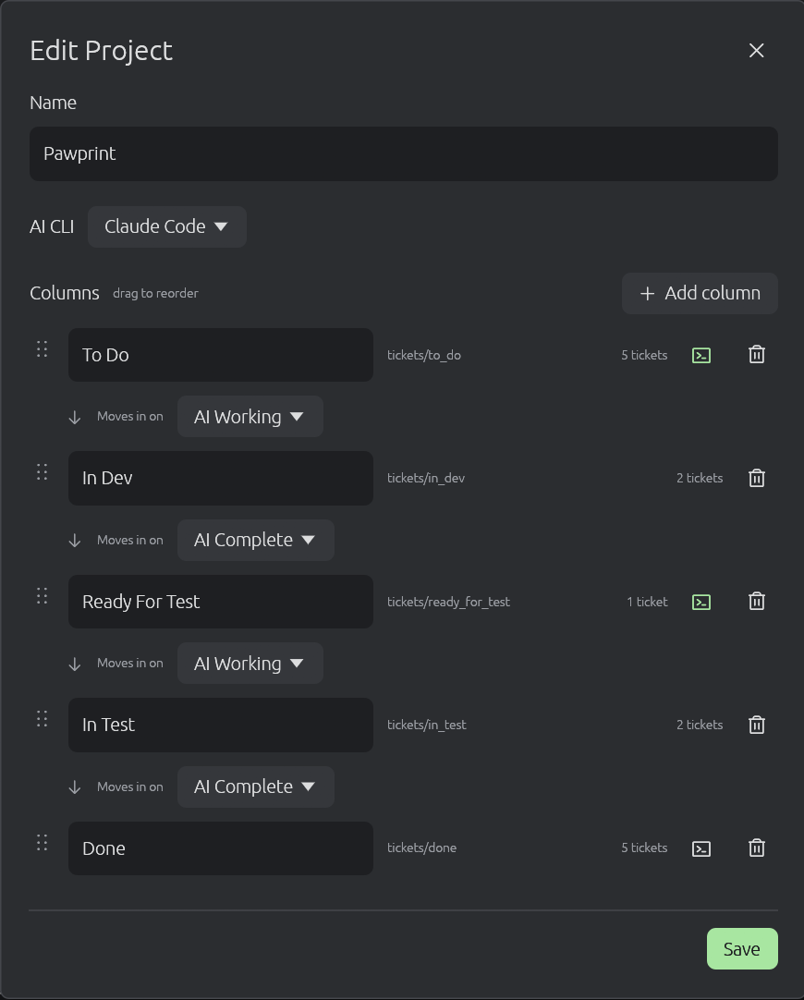
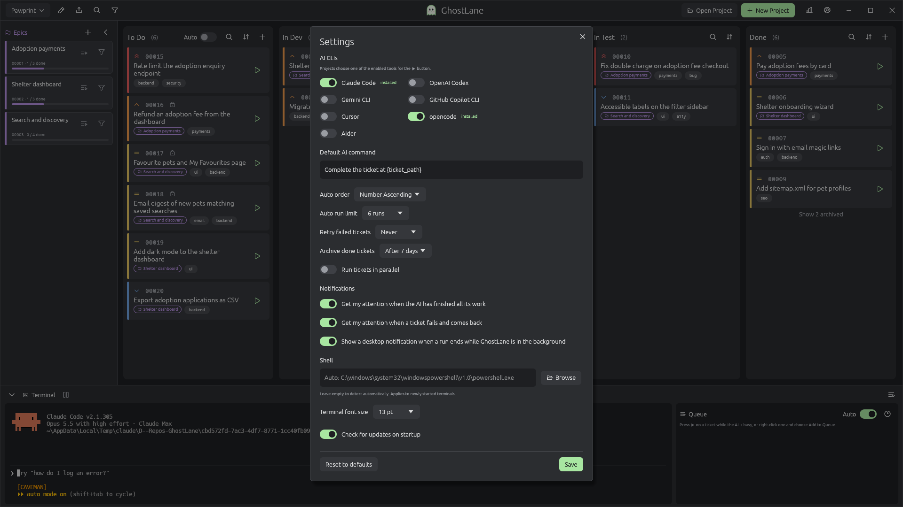

# 👻 GhostLane

**Plan the work. Hand it to your AI. Watch it move across the board.**

AI coding tools are great at a well-scoped task and shaky at a vague, sprawling one. Ask for "add favourites to the app" in one prompt and you get a giant diff, half-finished edges and no clear way to check it. Split the same change into ten small tickets, each with a clear description and a test scope, and the same AI gets far more reliable.

GhostLane is a project board built for that way of working. Your AI writes the tickets, you shape them, and one click sends a ticket to Claude Code, Codex, Gemini or whichever CLI you use, running in a terminal right under the board. Every ticket is a Markdown file in your repo, so the plan sits next to the code, diffs cleanly in git, and is something your AI can read for context.

Native app for Windows, macOS and Linux, written in Rust. No account, no server, no subscription.

**[⬇ Download the latest release](../../releases/latest)**



---

## Why GhostLane for AI work?

- **Big changes become a queue of small prompts.** Break a feature into tickets, give each one a test scope, then hand them to your AI one at a time. You review ticket 3 while ticket 4 runs, and nothing gets lost in a scrollback.
- **Your AI writes the tickets.** Describe what you want in a sentence. GhostLane asks the project's AI CLI to read the codebase and write a full ticket with a priority, a description and a test scope.
- **One click to run.** The ▶ button on every card sends that ticket to your AI CLI. If the CLI is already open in the terminal, GhostLane types the prompt straight into it.
- **Tickets move themselves.** Press ▶ on a To Do ticket and it slides into In Dev while the AI works, then on to Ready For Test when it's done. Testing works the same way, so a ticket can go from idea to Done with two clicks.
- **A Developer and a Tester on call.** GhostLane sets up developer and tester sub agents for your AI CLI that know your columns, which tickets are theirs and where to move them next.
- **The AI can see the plan.** Tickets live in `tickets/` inside your project, so your AI can read past and upcoming work, and can create or edit tickets itself. The board picks up every change the moment the file changes.
- **Bring your own AI.** Claude Code, OpenAI Codex, Gemini CLI, GitHub Copilot CLI, Cursor, opencode and Aider are built in. Each project picks its own.
- **Plain files, no lock-in.** A ticket is a `.md` file with a short YAML header. Grep it, commit it, edit it in any editor. If you stop using GhostLane tomorrow, your plan is still readable.

---

## Features

### AI-assisted tickets

Press **➕** on any column and the New Ticket dialog opens on the **AI Assisted** tab. Type what the ticket should do and press **Generate Ticket**.



GhostLane sends the request to the project's AI CLI in the terminal. The AI looks through the project for context, then writes the ticket file. While it works, the board shows a Generating card and the ghost in the title bar eats a trail of dots. The terminal stays free, so you can approve any permission prompts the AI asks for.



When the file appears, the new ticket lands on the board. If the CLI exits early or something goes wrong, GhostLane tells you what happened.

Existing tickets work the same way. Open a ticket, click the pencil, and the **AI Assisted** tab lets you say what should change ("raise the priority and add a test for expired links"). The AI updates the file in place and keeps its ID and run count.

Prefer to write it yourself? The **Manual** tab is always one click away.

### Send a ticket to AI with one click

Every card has a ▶ button. Press it and GhostLane fills in that column's command and hands it to the project's AI CLI in the terminal. The ticket's run count goes up, so you can see at a glance what has already been attempted.

Busy AI? While it works, the ▶ on each card turns into an add-to-queue button. Each extra ticket joins a queue and starts the moment the AI finishes the one before it. The queue icon at the right of the terminal bar turns green when tickets are waiting; click it to open the queue beside the terminal, drag tickets into the order you want, or remove any you've changed your mind about.

Want it hands-free? Flip the **Auto** switch on a column whose tickets the AI picks up (like To Do or Ready For Test). Whenever the queue is empty, GhostLane starts the next ticket from your Auto columns by itself, in the **Auto order** you choose in Settings (highest priority first, unless you change it). On a tie, the ticket further along the board goes first, so work gets finished before new work starts. Auto switches off when you close GhostLane, so a project never sets the AI going until you say so.

Each column can have its own command. New projects come with two ready to go:

- **To Do** asks the AI to develop the ticket and move it to Ready For Test when it's finished.
- **Ready For Test** asks the AI to test the ticket against its test scope. If it passes, the ticket moves to Done. If it fails, the AI writes down why in the ticket's notes and sends it back to To Do.

Every other column uses the command from Settings (by default *"Complete the ticket at {ticket_path}"*) until you give it its own.

When you open a project, GhostLane starts its AI CLI in the terminal for you, so it's ready before you need it.

### A terminal that's always there

A real shell sits at the bottom of the window, opened in your project folder: PowerShell on Windows, your usual shell on macOS and Linux. `git`, `cargo`, `npm` and your AI CLI are right there. Drag the top edge to resize it, or collapse it when you want the whole board.

### A visual ticket editor

Tickets are edited like a document, not like source code. Headings, bullet and numbered lists, checklists, quotes, code blocks, bold, italic, inline code and links all show formatted as you type. Markdown shortcuts such as `- ` or `## ` format the line for you, and Ctrl+B and Ctrl+I work as you'd expect.



Behind the scenes it's still plain Markdown. If a ticket uses Markdown the editor can't show (a table, say), that field opens as plain text so nothing gets lost, and fields you don't touch are saved exactly as they were.

### Tickets with everything you need

Every ticket has:

- an **ID** that counts up automatically (`00001`, `00002`, …) and is never reused
- a **title**
- a **priority**: Low, Medium, High or Highest, each with its own colour-coded icon
- a **description**
- an optional **test scope**, so you and your AI agree on what "done" means
- optional **notes** for anything else worth keeping with the ticket
- a **run count** showing how many times the ticket has been sent to AI

Click a card to read it with the Markdown fully rendered. Right-click it to **Edit**, **Duplicate** or **Delete**. Deleted tickets go to your Recycle Bin or Trash, so you can get them back.

### Boards shaped to your workflow

New projects start with **To Do → In Dev → Ready For Test → In Test → Done**. Click the pencil next to the project name to change that: drag columns into a new order, rename them, add more or remove some. If a column you remove still has tickets, GhostLane asks where to move them first. This is also where you pick the project's AI CLI, and where the terminal icon on each column opens that column's ▶ command.



Each column is a folder with a safe, predictable name, so `Ready For Test` becomes `tickets/ready_for_test/`. Drag a card to another column and the file moves on disk. Move a file in Explorer, Finder or the terminal and the card moves on the board.

### Tickets that move themselves

Between each pair of columns is a dropdown that decides when tickets move on without you dragging them:

- **None**: tickets only move when you or your AI move them.
- **AI Working**: the moment you press ▶ on a ticket, it moves into the next column, so the board shows what the AI is busy with. Columns filled this way have no ▶ button of their own, since the AI is already on it.
- **AI Complete**: when the AI finishes the ticket, it moves into the next column.

New projects come set up as **To Do →** *AI Working* **→ In Dev →** *AI Complete* **→ Ready For Test →** *AI Working* **→ In Test →** *AI Complete* **→ Done**.

GhostLane decides the AI has finished once the terminal goes quiet, so if your AI CLI stops to ask for permission, approve it promptly or the ticket may move on early.

### Your AI knows the board

Whenever you create or save a project, GhostLane writes a short guide to your columns, their folders and the ticket format into the instructions file your AI CLI reads: `CLAUDE.md` for Claude Code, `AGENTS.md` for Codex, Cursor and opencode, `GEMINI.md` for Gemini CLI, `.github/copilot-instructions.md` for Copilot and `CONVENTIONS.md` for Aider. The guide sits in its own marked block, so anything else you keep in that file stays as it is.

Where the CLI supports sub agents (Claude Code, Codex, Gemini CLI, GitHub Copilot CLI, Cursor and opencode), GhostLane also sets up two of them:

- a **Developer** that picks up tickets waiting for development, moves them into the development column before starting and on for testing when the work is done
- a **Tester** that checks finished work against each ticket's test scope, passes it on, or notes what failed and sends it back for rework

Both know every column, its folder and how tickets move between them, and GhostLane rewrites them whenever you change your columns or transitions. If you already have your own agent file with the same name, GhostLane leaves it alone.

### Search and sort every column

Each column header shows a live ticket count and three quick tools:

- 🔍 **Search** filters the column as you type, matching on ID, title, description, test scope and notes.
- ⇅ **Sort** orders tickets by ID, priority or title, ascending or descending. GhostLane remembers your choice for each column.
- ➕ **Add** creates a new ticket directly in that column.

### Projects that switch in a click

Open as many projects as you like and switch between them from the dropdown in the title bar. Each project keeps its own board, its own columns and its own terminal session. GhostLane remembers which projects you had open, and if a project's files have been moved or deleted, it drops it from the list on launch.

### Your settings

Click the ⚙ cog to choose:

- which **AI CLIs** are available to your projects (installed ones are switched on for you the first time)
- the **Default AI command** the ▶ button sends for columns that don't have their own, with the placeholders `{ticket_path}`, `{ticket_id}` and `{project_dir}`
- the **Auto order** your Auto columns work through tickets in: by priority or by number, ascending or descending
- which **shell** to use (detected automatically by default)
- the **terminal font size**



For safety, GhostLane never puts a ticket's title or text into the command, and refuses to run if a path or ID contains shell characters such as quotes, `$`, `;` or `|`. That matters when you open a repo full of tickets someone else wrote. Column commands are saved in the project file, so when you open someone else's project, glance at them in the project settings before you press ▶.

### Easy on the eyes

Dark greys with a soft pale green accent, made for long sessions. The title bar is drawn in the same style, with the window controls built in.

---

## How it looks on disk

```
my-project/
├── my_project.ghost        ← project settings (YAML)
├── CLAUDE.md               ← ticket guide for your AI CLI
├── .claude/agents/         ← Developer and Tester sub agents
└── tickets/
    ├── to_do/
    │   ├── 00001.md
    │   └── 00004.md
    ├── in_dev/
    │   └── 00002.md
    ├── ready_for_test/
    ├── in_test/
    └── done/
        └── 00003.md
```

A ticket file looks like this:

```markdown
---
id: 00001
title: Login page
priority: high
run_count: 2
---

## Description

Build the login form with email and password fields.

## Test Scope

- valid credentials log the user in
- invalid credentials show an error

## Notes

First test run: the error message overlapped the password field.
```

You, your teammates or your AI can write tickets like this by hand, and GhostLane picks them up straight away. Try asking your AI in the terminal to split a feature into tickets and watch them land in To Do.

---

## Getting started

1. **Download** the build for your platform from the [releases page](../../releases/latest) and run it.
2. Click **New Project**, give it a name and choose a folder. An existing code repository works well, since that's what your AI will read.
3. Pick the project's AI CLI, adjust the columns if you like, then click **Create**.
4. Press **➕** on a column and describe your first ticket on the **AI Assisted** tab, or write it yourself on **Manual**.
5. Press **▶** on a To Do ticket to hand it to your AI. It moves into In Dev while the AI works and on to Ready For Test when it's done; press ▶ there to have it tested. You can always drag cards yourself too.

To open an existing project, click **Open Project** and select its `.ghost` file.

---

## Build from source

You need a recent stable [Rust toolchain](https://rustup.rs).

```sh
git clone https://github.com/EdTheDuck/GhostLane.git
cd GhostLane
cargo build --release
```

On Linux, install the GUI and dialog dependencies first, for example on Debian or Ubuntu:

```sh
sudo apt install libxkbcommon-dev libgtk-3-dev libwayland-dev libxcb-render0-dev libxcb-shape0-dev libxcb-xfixes0-dev
```

---

## Built with

[egui](https://github.com/emilk/egui) · [egui_commonmark](https://github.com/lampsitter/egui_commonmark) · [egui_term](https://github.com/Harzu/egui_term) · [notify](https://github.com/notify-rs/notify) · [rfd](https://github.com/PolyMeilex/rfd) · [trash](https://github.com/Byron/trash-rs)

Bold text uses [Ubuntu Bold](https://design.ubuntu.com/font) under the Ubuntu Font Licence.

---

*GhostLane: work that moves quietly from lane to lane.* 👻
