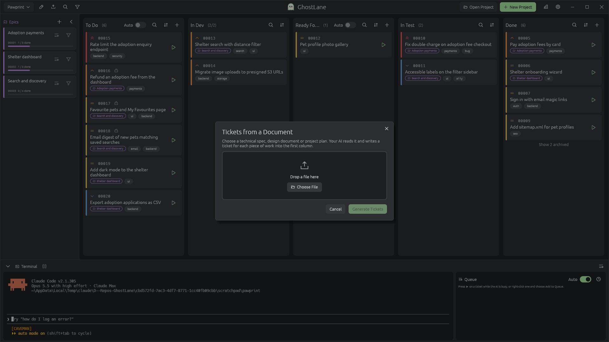

# 👻 GhostLane

**Plan the work. Hand it to your AI. Watch it move across the board.**

AI coding tools are great at a well-scoped task and shaky at a vague, sprawling one. Ask for "add favourites to the app" in one prompt and you get a giant diff, half-finished edges and no clear way to check it. Split the same change into ten small tickets, each with a clear description and a test scope, and the same AI gets far more reliable.

GhostLane is a project board built for that way of working. Your AI writes the tickets, you shape them, and one click sends a ticket to Claude Code, Codex, Gemini or whichever CLI you use, running in a terminal right under the board. Every ticket is a Markdown file in your repo, so the plan sits next to the code, diffs cleanly in git, and is something your AI can read for context.

Native app for Windows, macOS and Linux, written in Rust. No account, no server, no subscription.

**[⬇ Download the latest release](../../releases/latest)**


---

## Why GhostLane for AI work?

- **Big changes become a queue of small prompts.** Break a feature into tickets, give each one a test scope, then hand them to your AI one at a time. You review ticket 3 while ticket 4 runs, and nothing gets lost in a scrollback.
- **Your AI writes the tickets.** Describe what you want in a sentence. GhostLane asks the project's AI CLI to read the codebase and write a full ticket with a priority, a description and a test scope.
- **One click to run.** The ▶ button on every card sends that ticket to your AI CLI. If the CLI is already open in the terminal, GhostLane types the prompt straight into it.
- **Hands-free when you want it.** Queue up tickets while the AI is busy, or switch a column to Auto and let it work through the backlog by itself. Pause or stop it whenever you need to step in.
- **Tickets move themselves.** Press ▶ on a To Do ticket and it slides into In Dev while the AI works, then on to Ready For Test when it's done. Testing works the same way, so a ticket can go from idea to Done with two clicks.
- **A Developer and a Tester on call.** GhostLane sets up developer and tester sub agents for your AI CLI that know your columns, which tickets are theirs and where to move them next.
- **The AI can see the plan.** Tickets live in `tickets/` inside your project, so your AI can read past and upcoming work, and can create or edit tickets itself. The board picks up every change the moment the file changes.
- **Bring your own AI.** Claude Code, OpenAI Codex, Gemini CLI, GitHub Copilot CLI, Cursor, opencode and Aider are built in. Each project picks its own.
- **Plain files, no lock-in.** A ticket is a `.md` file with a short YAML header. Grep it, commit it, edit it in any editor. If you stop using GhostLane tomorrow, your plan is still readable.

---

## Features

### AI-assisted tickets

Press **➕** on any column and the New Ticket dialog opens on the **AI Assisted** tab. Type what the ticket should do and press **Generate Ticket**.


GhostLane sends the request to the project's AI CLI in the terminal. The AI looks through the project for context, then writes the ticket file. While it works, the board shows a Generating card and the ghost in the title bar eats a trail of dots. The terminal stays free, so you can approve any permission prompts the AI asks for.


When the file appears, the new ticket lands on the board. If the CLI exits early or something goes wrong, GhostLane tells you what happened.

Existing tickets work the same way. Open a ticket, click the pencil, and the **AI Assisted** tab lets you say what should change ("raise the priority and add a test for expired links"). The AI updates the file in place and keeps its ID and run count.

Prefer to write it yourself? The **Manual** tab is always one click away.

### Tickets from a spec or plan

Already have a technical spec, design doc or project plan? Click the upload icon next to the project name and choose the file, or just drop it anywhere on the window. Press **Generate Tickets** and your AI reads the document and writes a ticket for each piece of work into the first column, skipping anything that already has a ticket. The new tickets appear on the board as they're written.



### Send a ticket to AI with one click

Every card has a ▶ button. Press it and GhostLane fills in that column's command and hands it to the project's AI CLI in the terminal. The ticket's run count goes up, so you can see at a glance what has already been attempted.

Busy AI? While it works, the ▶ on each card turns into an add-to-queue button. Each extra ticket joins a queue and starts the moment the AI finishes the one before it. The queue icon at the right of the terminal bar turns green when tickets are waiting; click it to open the queue beside the terminal, drag tickets into the order you want, or remove any you've changed your mind about.

Want it hands-free? Flip the **Auto** switch on a column whose tickets the AI picks up (like To Do or Ready For Test). Whenever the queue is empty, GhostLane starts the next ticket from your Auto columns by itself, in the **Auto order** you choose in Settings (highest priority first, unless you change it). On a tie, the ticket further along the board goes first, so work gets finished before new work starts. Auto switches off when you close GhostLane, so a project never sets the AI going until you say so.

A ticket that keeps failing its tests won't loop forever: once it has been sent to the AI as many times as the **Auto run limit** in Settings (6 by default), Auto skips it and its card shows a red flag. Press ▶ to give it another go yourself, or right-click it and choose **Reset Run Count**.

Need to step in? The terminal bar has a ⏸ **Pause** button that lets the AI finish the ticket it's on and then starts nothing new, and a ⏹ **Stop** button that interrupts the AI straight away, leaves the ticket where it is and pauses the queue. Press ▶ **Resume** when you're ready.

GhostLane also gets your attention when you're in another window: the taskbar flashes (or the Dock icon bounces) when the AI has run out of work, and when a ticket fails and comes back to an earlier column.

Each column can have its own command. New projects come with two ready to go:

- **To Do** asks the AI to develop the ticket and move it to Ready For Test when it's finished.
- **Ready For Test** asks the AI to test the ticket against its test scope. If it passes, the ticket moves to Done. If it fails, the AI writes down why in the ticket's notes and sends it back to To Do.

Every other column uses the command from Settings (by default *"Complete the ticket at {ticket_path}"*) until you give it its own.

When you open a project, GhostLane starts its AI CLI in the terminal for you, so it's ready before you need it.

### A terminal that's always there

A real shell sits at the bottom of the window, opened in your project folder: PowerShell on Windows, your usual shell on macOS and Linux. `git`, `cargo`, `npm` and your AI CLI are right there. Drag the top edge to resize it, or collapse it when you want the whole board.

### A visual ticket editor

Tickets are edited like a document, not like source code. Headings, bullet and numbered lists, checklists, quotes, code blocks, bold, italic, inline code and links all show formatted as you type. Markdown shortcuts such as `- ` or `## ` format the line for you, and Ctrl+B and Ctrl+I work as you'd expect.


Behind the scenes it's still plain Markdown. If a ticket uses Markdown the editor can't show (a table, say), that field opens as plain text so nothing gets lost, and fields you don't touch are saved exactly as they were.

### Tickets with everything you need

Every ticket has:

- an **ID** that counts up automatically (`00001`, `00002`, …) and is never reused
- a **title**
- a **priority**: Low, Medium, High or Highest, each with its own colour-coded icon
- a **description**
- an optional **test scope**, so you and your AI agree on what "done" means
- optional **notes** for anything else worth keeping with the ticket
- a **run count** showing how many times the ticket has been sent to AI
- optional **labels** such as `ui` or `backend`, shown as pills on the card; click one to filter the board by it
- an optional **Blocked by** list of tickets that have to be finished first
- a **run history**: every time the AI worked on it, how long it took, where the ticket went, how it ended and, with Claude Code, how many tokens it used

Click a card to read it with the Markdown fully rendered, including its run history. Right-click it to **Edit**, **Duplicate** or **Delete**. Deleted tickets go to your Recycle Bin or Trash, so you can get them back.

### Boards shaped to your workflow

New projects start with **To Do → In Dev → Ready For Test → In Test → Done**. Click the pencil next to the project name to change that: drag columns into a new order, rename them, add more or remove some. If a column you remove still has tickets, GhostLane asks where to move them first. This is also where you pick the project's AI CLI, and where the terminal icon on each column opens that column's ▶ command.


Give a column a **WIP limit** to keep work in progress in check: its header shows `(4/3)` in red when there are too many tickets in it, and Auto won't move another ticket in until there's room.

Each column is a folder with a safe, predictable name, so `Ready For Test` becomes `tickets/ready_for_test/`. Drag a card to another column and the file moves on disk. Move a file in Explorer, Finder or the terminal and the card moves on the board.

### Tickets that move themselves

Between each pair of columns is a dropdown that decides when tickets move on without you dragging them:

- **None**: tickets only move when you or your AI move them.
- **AI Working**: the moment you press ▶ on a ticket, it moves into the next column, so the board shows what the AI is busy with. Columns filled this way have no ▶ button of their own, since the AI is already on it.
- **AI Complete**: when the AI finishes the ticket, it moves into the next column.

New projects come set up as **To Do →** *AI Working* **→ In Dev →** *AI Complete* **→ Ready For Test →** *AI Working* **→ In Test →** *AI Complete* **→ Done**.

With Claude Code and OpenAI Codex, GhostLane knows exactly when the AI has finished: it starts them with a small completion hook, so a ticket waits patiently while the CLI asks you for permission. Other CLIs count as finished once the terminal goes quiet, so if one stops to ask for permission, approve it promptly or the ticket may move on early. Nothing is written into your project for this; the hook lives in GhostLane's own settings folder.

### Work in the right order

Some tickets can't start until others are finished. Type their numbers into a ticket's **Blocked by** field (or let your AI fill it in when it writes tickets from a spec) and the card shows a 🔒 until every one of them reaches the last column. Auto and the queue skip a blocked ticket and come back to it once it's free, so ticket 4 never starts before ticket 3 is done. Need it now anyway? ▶ still runs it straight away.

Hover over a card to see how it connects: arrows run from the tickets it waits for to it, and from it to the tickets waiting on it, red while the one at the start isn't done yet. Open a ticket and it lists both sides, **Blocked by** and **Blocks**; click one to jump straight to it.

### Done means done

The **Settings** section of the project dialog decides what happens when a ticket reaches the last column:

- **Commit when ticket is done** commits everything in the project's git repository, with the ticket's number and title as the message (`00012: Add a logout button`). Every ticket becomes one tidy, revertable commit.
- **Push when commit is made** (shown once committing is on) pushes each of those commits straight away.
- **Test command**, such as `cargo test` or `npm test`, runs in the project folder whenever the AI finishes a ticket in the last column. The ticket only stays there if the command passes. If it fails, the ticket goes back to the first column with the command's output in its notes, so the next run knows exactly what broke. A hard check on top of the AI tester's judgement.

These settings stay on your computer instead of in the project file, so opening someone else's repo never commits, pushes or runs a command by itself.

### See exactly what the AI changed

Open a ticket and switch to its **Changes** tab to read the diff of everything the AI changed for it, new files included. GhostLane notes the commit each run starts from, so the diff is there even before anything is committed. Ticket files stay out of it, so you only see the real work.

Happy with it? **Approve** moves the ticket to the last column (and commits it, if the project commits on done). Not quite? Type what needs fixing and press **Reject**: your note goes into the ticket and it goes back to the first column for another pass. Add a Review column before Done and nothing slips through without you looking.

Once a ticket is done and committed, its run history shows the commit, and **Revert Commit** on the Changes tab undoes that ticket's work with a new commit. The ticket goes back to the first column, ready to try again. Your board itself is never rolled back.

### Work on many tickets at once

Ctrl-click cards (Cmd-click on macOS) to pick several, or Shift-click to pick a run of them in a column. A bar above the board lets you send them all to the AI (the first starts now, the rest queue up), move them to another column, change their priority or delete them. Dragging one selected card brings the rest along. Esc clears the selection.

Moved or deleted something by mistake? **Ctrl+Z** puts it back.

Prefer the keyboard? With nothing else focused, the **arrow keys** walk between cards, **Enter** opens one, **Space** adds it to the selection, **[** and **]** move it (or the whole selection) a column left or right, and **Delete** deletes it.

### See how it's going

The chart icon in the title bar opens the project's stats: tickets done each day for the last two weeks, how many AI runs there have been, how long a run takes on average, how many tickets passed on the first try, how many tokens the AI has used (with Claude Code), and which tickets needed the most runs.

### Take the board with you

The **Export** buttons in the project dialog (the pencil next to the project name) save the board as a **CSV file** of every ticket (number, title, column, priority, labels, runs, blockers and when it was done) for a spreadsheet, or as a **Markdown report** grouped by column, handy as a status update or a starting point for release notes.

### Your AI knows the board

Whenever you create or save a project, GhostLane writes a short guide to your columns, their folders and the ticket format into the instructions file your AI CLI reads: `CLAUDE.md` for Claude Code, `AGENTS.md` for Codex, Cursor and opencode, `GEMINI.md` for Gemini CLI, `.github/copilot-instructions.md` for Copilot and `CONVENTIONS.md` for Aider. The guide sits in its own marked block, so anything else you keep in that file stays as it is.

Where the CLI supports sub agents (Claude Code, Codex, Gemini CLI, GitHub Copilot CLI, Cursor and opencode), GhostLane also sets up two of them:

- a **Developer** that picks up tickets waiting for development, moves them into the development column before starting and on for testing when the work is done
- a **Tester** that checks finished work against each ticket's test scope, passes it on, or notes what failed and sends it back for rework

Both know every column, its folder and how tickets move between them, and GhostLane rewrites them whenever you change your columns or transitions. If you already have your own agent file with the same name, GhostLane leaves it alone.

### Search and sort every column

Each column header shows a live ticket count and three quick tools:

- 🔍 **Search** filters the column as you type, matching on ID, title, labels, description, test scope and notes. Type `label:ui` to see only tickets with that label.
- ⇅ **Sort** orders tickets by ID, priority or title, ascending or descending. GhostLane remembers your choice for each column.
- ➕ **Add** creates a new ticket directly in that column.

Want to see just part of the board? The funnel in the title bar opens a filter bar: pick priorities, labels, only blocked tickets, or tickets that have needed a certain number of runs, and every column narrows down at once.

Looking for one ticket? Press **Ctrl+K** (Cmd+K on macOS) or the magnifying glass in the title bar, type a number or a few words, and jump straight to it from any column. The same box runs commands too: type `stats`, `auto` or `export`, or start with `>` to list them all, from adding a ticket to any column to switching projects or pausing the AI.

The last column stays short: tickets that have been done for a while (a week by default) tuck away behind a **Show archived** link at the bottom. Their files stay right where they are, and a search still finds them.

### Projects that switch in a click

Open as many projects as you like and switch between them from the dropdown in the title bar. Each project keeps its own board, its own columns and its own terminal session. GhostLane remembers which projects you had open, and if a project's files have been moved or deleted, it drops it from the list on launch.

### Your settings

Click the ⚙ cog to choose:

- which **AI CLIs** are available to your projects (installed ones are switched on for you the first time)
- the **Default AI command** the ▶ button sends for columns that don't have their own, with the placeholders `{ticket_path}`, `{ticket_id}` and `{project_dir}`
- the **Auto order** your Auto columns work through tickets in: by priority or by number, ascending or descending
- the **Auto run limit**: how many times a ticket can be sent to the AI before Auto skips it
- **Archive done tickets**: how long a ticket stays in view in the last column before it's tucked away
- **notifications**: whether GhostLane gets your attention when the AI runs out of work and when a ticket fails, and whether it pops up a desktop notification each time a run ends while you're working in another window
- which **shell** to use (detected automatically by default)
- the **terminal font size**
- whether to **check for updates** on startup. When a newer release is out, an **Update** button appears in the title bar and takes you to the download.


For safety, GhostLane never puts a ticket's title or text into the command, and refuses to run if a path or ID contains shell characters such as quotes, `$`, `;` or `|`. That matters when you open a repo full of tickets someone else wrote. Column commands are saved in the project file, so when you open someone else's project, glance at them in the project settings before you press ▶.

### Easy on the eyes

Dark greys with a soft pale green accent, made for long sessions. The title bar is drawn in the same style, with the window controls built in.

---

## How it looks on disk

```
my-project/
├── my_project.ghost        ← project settings (YAML)
├── CLAUDE.md               ← ticket guide for your AI CLI
├── .claude/agents/         ← Developer and Tester sub agents
└── tickets/
    ├── to_do/
    │   ├── 00001.md
    │   └── 00004.md
    ├── in_dev/
    │   └── 00002.md
    ├── ready_for_test/
    ├── in_test/
    └── done/
        └── 00003.md
```

A ticket file looks like this:

```markdown
---
id: 00001
title: Login page
priority: high
run_count: 2
labels:
- ui
blocked_by:
- '00002'
---

## Description

Build the login form with email and password fields.

## Test Scope

- valid credentials log the user in
- invalid credentials show an error

## Notes

First test run: the error message overlapped the password field.
```

You, your teammates or your AI can write tickets like this by hand, and GhostLane picks them up straight away. Try asking your AI in the terminal to split a feature into tickets and watch them land in To Do.

---

## Getting started

1. **Download** the build for your platform from the [releases page](../../releases/latest) and run it.
2. Click **New Project**, give it a name and choose a folder. An existing code repository works well, since that's what your AI will read.
3. Pick the project's AI CLI, adjust the columns if you like, then click **Create**.
4. Press **➕** on a column and describe your first ticket on the **AI Assisted** tab, or write it yourself on **Manual**. Got a spec or plan already? Drop it on the window and let your AI turn it into tickets.
5. Press **▶** on a To Do ticket to hand it to your AI. It moves into In Dev while the AI works and on to Ready For Test when it's done; press ▶ there to have it tested. You can always drag cards yourself too.

To open an existing project, click **Open Project** and select its `.ghost` file.

---

## Build from source

You need a recent stable [Rust toolchain](https://rustup.rs).

```sh
git clone https://github.com/EdTheDuck/GhostLane.git
cd GhostLane
cargo build --release
```

On Linux, install the GUI and dialog dependencies first, for example on Debian or Ubuntu:

```sh
sudo apt install libxkbcommon-dev libgtk-3-dev libwayland-dev libxcb-render0-dev libxcb-shape0-dev libxcb-xfixes0-dev
```

---

## Built with

[egui](https://github.com/emilk/egui) · [egui_commonmark](https://github.com/lampsitter/egui_commonmark) · [egui_term](https://github.com/Harzu/egui_term) · [notify](https://github.com/notify-rs/notify) · [rfd](https://github.com/PolyMeilex/rfd) · [trash](https://github.com/Byron/trash-rs)

Bold text uses [Ubuntu Bold](https://design.ubuntu.com/font) under the Ubuntu Font Licence.

---

## License

[MIT](LICENSE)

---

*GhostLane: work that moves quietly from lane to lane.* 👻
